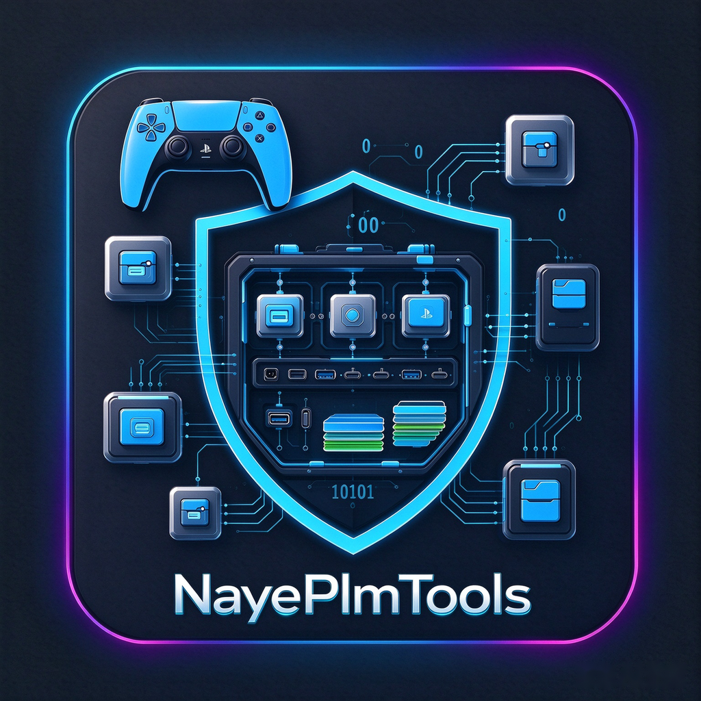

  

<h1 align="center">Support & Donations</h1>

  <b>Payload Manager</b> is a free and open-source project created for the PlayStation 5 homebrew community. 
  If you find this tool helpful and would like to support ongoing development or just say thanks, every contribution is warmly appreciated!

  
  &nbsp;&nbsp;&nbsp;&nbsp;
  

---

### 💳 Sponsorship Platforms

| Platform | Accepted Payment Methods | Link |
| :--- | :--- | :--- |
| **GitHub Sponsors** | Monthly or one-time &bull; Credit Card | [Sponsor @itsPLK](https://github.com/sponsors/itsPLK) |
| **Buy Me a Coffee** | One-time support &bull; Credit Card, Apple Pay, Google Pay | [buymeacoffee.com/najdek](https://www.buymeacoffee.com/najdek) |

### 🪙 Cryptocurrency

If you prefer donating via cryptocurrency, you can send to any of the wallet addresses below:

| | Coin | Address |
| :---: | :--- | :--- |
|  | **Bitcoin (BTC)** | `bc1qxlq6tpq23kvr57ne80qtwvnctvq6f7qrehh8xr` |
|  | **Ethereum (ETH)** | `0x38e3a4Cb21Fb78E67C7C3e56e79c535B85868632` |
|  | **Bitcoin Cash (BCH)** | `qqmnmte7xmj24wj4t6yzwksespyfanyayy3g02eq2x` |
|  | **Litecoin (LTC)** | `ltc1qmtg2k6753cefwf4l3fpau4qheuemevqa35uz2g` |

---

  <i>Thank you for your generosity and for supporting open-source PS5 homebrew! ❤️</i>

