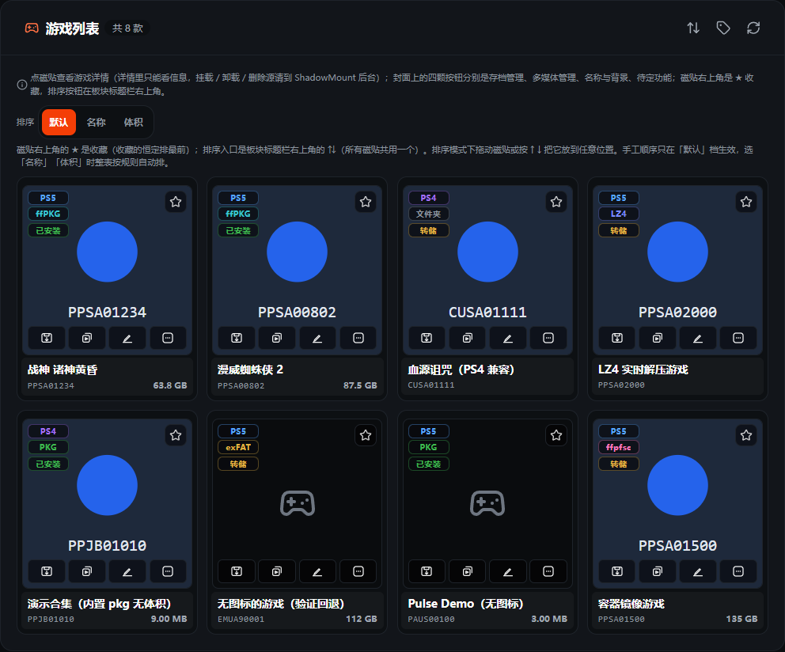

<p align="center">
 
</p>

<h1 align="center">NayePlmTools</h1>

<p align="center">
  PS5 Payload Manager 中文增强分支（CN-FORK）—— 在原版基础上把「改了面板却没写进主机」的功能全部打通。
</p>

<p align="center">
  <a href="https://github.com/naye1120/NayePlmTools/releases"></a>
  <a href="https://github.com/naye1120/NayePlmTools/stargazers"></a>
  <a href="https://github.com/naye1120/NayePlmTools/blob/main/LICENSE"></a>
</p>

<p align="center">
 
</p>

---

## 这是什么

**NayePlmTools** 是基于 [itsPLK/ps5-payload-manager](https://github.com/itsPLK/ps5-payload-manager) 的
中文分支，由 **naye** 维护。原版是一个跑在 PS5 上的网页版 Payload 管理面板；本分支在保留其全部能力的
前提下，**补齐了「面板改了、主机没改」这一类断链的功能**，并针对中文用户与电视端（遥控器）做了适配。

- 仓库地址：**https://github.com/naye1120/NayePlmTools**
- 上游项目：https://github.com/itsPLK/ps5-payload-manager

---

## 核心增强（相对原版）

原版有很多功能只改到「面板自己记着」，重启主机或 SMP 重扫就回到原样。本分支把这些功能**真正写进主机**。

### 🎮 游戏管理

| 功能 | 说明 |
| :--- | :--- |
| **游戏改名（写回主机）** | 名称同时写回系统 `app.db` 与 `appinfo.db` 的**整套语言槽位**（`TITLE` + `TITLE_00..30`、`concept_name` + `concept_name_00..30`），电视主屏与 ShadowMountPlus 跟着变。简体中文系统读的是 `TITLE_11` —— 这正是「只有一个位置变了」的根因，已修复。 |
| **背景音乐（写进游戏包）** | PS5 磁贴音乐只认游戏包里的 `sce_sys/snd0.at9`（ATRAC9）。本分支在**浏览器里**用内置的 ATRAC9 编码器转码后写进游戏包，并写入响度元数据、备份原件。以前只存在面板自己目录里，主机根本不读。 |
| **自定义图标 / 背景** | 更换磁贴图标与背景图。 |
| **置顶（写主机）** | 写进 `app.db` 的 `MyHome` 固定列表（`idx` 就是主屏位置），并放开「只能置顶内置软件」的限制 —— **游戏也能置顶**。 |
| **拖拽排序** | 点「排序」进入排序模式，磁贴左上角显示位置号，拖到想要的位置松手即写回主机；电视端可用上移 / 下移 / 移到最前。 |
| **多媒体管理 + 分享二维码** | 浏览 / 下载游戏内多媒体资源；分享按钮生成的二维码**扫码直接开始下载**（单文件直链，多选 / 全量先打包再给链接）。 |
| **从 USB 移动** | 把游戏从 USB 移动到内置存储。 |

### 💾 存档管理

| 功能 | 说明 |
| :--- | :--- |
| **远程拉取 / 推送** | 支持 **FTP + HTTP + SMB** 三协议平权，远端布局 `<base>/<TID>/<uid>.zip`。 |
| **本地快照** | 每次游戏退出后自动存一份，落 `/data/nayeplmtools/saves_snap/`，全局 512MB 预算。 |
| **garlic 兼容导入** | 兼容 garlic 导出的存档镜像（PS5 裸 `sdimg_*` / PS4 zip），**逐文件合并**、保留主机记账文件；整包成功才落盘（先写暂存目录再 rename）。 |
| **存档转换** | 把其它用户的存档一键转换到当前用户可用，逐文件合并而非整份替换。 |
| **拉取前比新旧** | 纯函数判定「远端是否比本地新」，说不清一律按该拉处理，避免误覆盖。 |
| **游戏运行中禁推拉** | 后端当场探测后拒绝，前端置灰并写明理由（电视端没有 hover，理由直接印在界面上）。 |
| **自动存档** | 启动时拉取 / 退出时回传；**跳过自制应用（homebrew）**，避免误推镜像、误拉覆盖。 |
| **拉取前冻结游戏** | 自动拉取前用**进程级 `SIGSTOP`** 冻住正在启动的游戏（不用 LncUtil 挂起 —— 那会让游戏跳后台且无法切回前台）。 |

### 🧩 其余模块

- **Payload 管理**：浏览 / 安装 / 更新 / 删除 payload；内置云端仓库与自定义来源；装完自动同步越狱引导器。
- **自动加载**：编排开机自动加载序列（延时行 + 载荷名），可上移 / 下移 / 插延时，写回幂等。
- **PKG 安装**：内嵌 PKG Manager，可在面板里上传、启停、更新版本。
- **账号工具**：登录 / 登出 / 反激活，头像上传与裁剪。
- **常用入口**：手动添加插件 / 局域网服务快捷卡片，逐条 TCP 探活，点卡片新标签打开。
- **风扇温控**：读风扇状态，向 `/dev/icc_fan` 下发目标温度。
- **其它**：远程游玩配对、SMP（ShadowMountPlus）探活与拉起、运行日志查看、活动进程查看。

### 🖥️ 界面

- 深色主题；**电视端（遥控器）适配**；**移动端二级菜单**（手机端 PKG 安装 / 常用配置 / 游戏管理 / 活动进程 / 设置 / 关于 收进下拉菜单，桌面与电视端保持原侧栏）。
- 刷新后停在当前页；存档、多媒体等面板「铺满右侧」。
- 多语言：继承上游 [Crowdin](https://crowdin.com/project/ps5-payload-manager) 的全部语言，并叠加本分支的中文文案覆盖层。

---

## 安装

### 配合 Autoloader（推荐）

推荐与 Autoloader 一起使用：

[Y2JB](https://github.com/itsPLK/ps5-y2jb-autoloader) |
[BD-JB](https://github.com/itsPLK/ps5-bdjb-autoloader) |
[Lua](https://github.com/itsPLK/ps5-lua-autoloader)

把 `NayePlmTools_<version>.elf` 放进 `autoload` 目录，并在 `autoload.txt` 里把它作为条目即可。
两个变体：

| 文件 | 磁贴落点 |
| :--- | :--- |
| `NayePlmTools_<version>-me.elf` | **媒体**栏（`NAYE00001`） |
| `NayePlmTools_<version>-ga.elf` | **游戏**栏（`NAYE00004`） |

### 手动加载

从 [Releases](https://github.com/naye1120/NayePlmTools/releases) 下载最新 `.elf`，像其它 payload 一样加载。
面板默认监听 `http://<PS5 IP>:8911`。

---

## 自定义仓库

可以添加第三方 payload 仓库。自定义仓库 JSON 的格式与托管方式见上游的
[Custom Repositories Guide](CUSTOM_REPOSITORIES.md)。

---

## 构建

前端为 React + Vite（产物是**单页 HTML**，会被内联进 ELF）；后端为 C + Prospero SDK。

```bash
# 1) 构建前端（产物 frontend/dist/index.html）
make frontend-build

# 2) 打包两个磁贴变体的 ELF（需要 PS5 payload SDK）
bash tools/build_tiles.sh
```

更细的构建与部署说明见 [DEVELOPMENT.md](DEVELOPMENT.md)；
接手维护前请先读 [HANDOVER.md](./HANDOVER.md)（本分支的事实来源与踩坑记录）。

---

## 致谢

- [itsPLK](https://github.com/itsPLK) —— 原版 Payload Manager 作者，本分支的上游。
- [John Törnblom](https://github.com/john-tornblom) —— [ps5-payload-sdk](https://github.com/ps5-payload-dev/sdk) 与多个参考 payload。
- [manos555555](https://github.com/manos555555) —— [PS5-Upload-Suite](https://github.com/manos555555/PS5-Upload-Suite)。
- [drakmor](https://github.com/drakmor) —— [ps5-hwinfo](https://github.com/drakmor/ps5-hwinfo)。
- [Pharaoh2k](https://github.com/Pharaoh2k) —— [ps5debug-NG](https://github.com/Pharaoh2k/ps5debug-NG)。
- [earthonion](https://github.com/earthonion) —— [garlic-savemgr](https://github.com/earthonion/garlic-savemgr)。
- [blackbearreloaded](https://github.com/blackbearreloaded) —— [ps5-at9-converter](https://github.com/blackbearreloaded/ps5-at9-converter)（本分支的浏览器端 ATRAC9 编码器移植自该项目）。
- [BenNoxXD](https://github.com/BenNoxXD) —— Disc Player 终止逻辑。
- [owendswang](https://github.com/owendswang) —— 上游贡献。
- 以及所有参与 PS5 homebrew 社区的开发者。

---

## 捐赠

如果这个分支帮到了你，可以请我喝杯咖啡：

<p align="center">
  
</p>

## 许可证

沿用上游项目的许可证，见 [LICENSE](LICENSE)。
